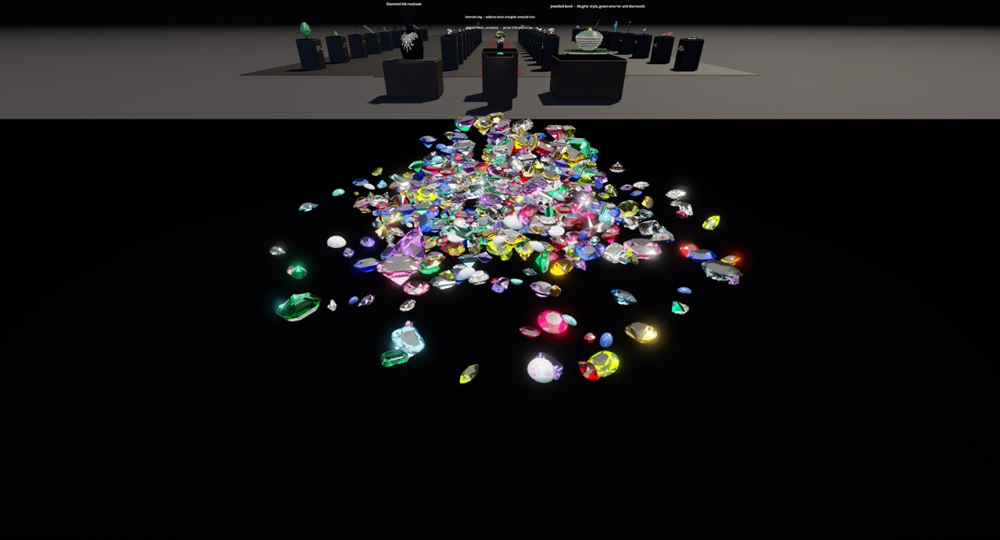
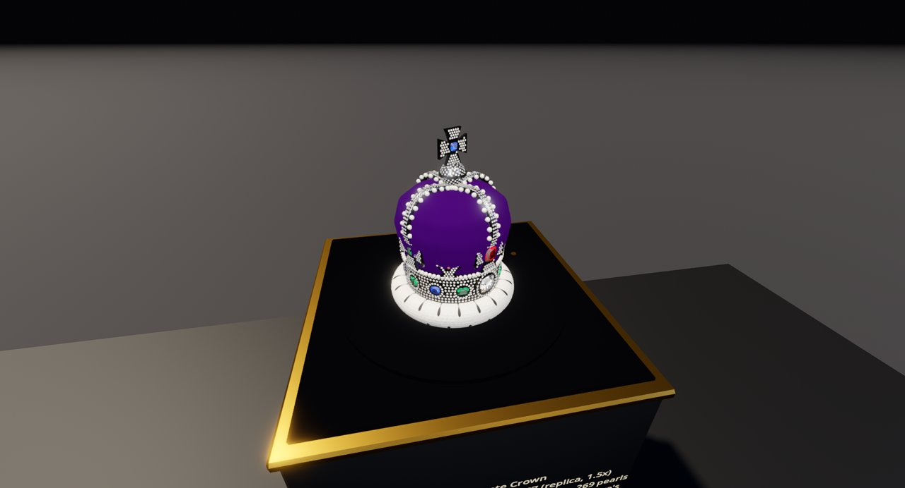
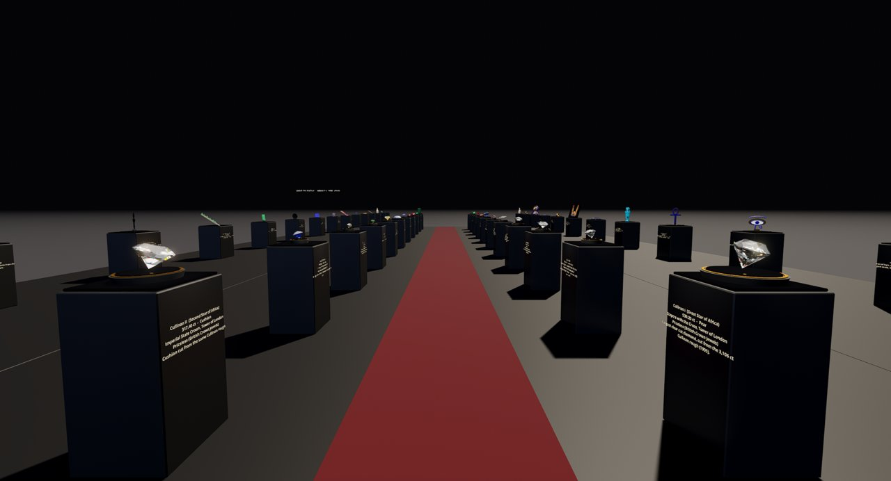
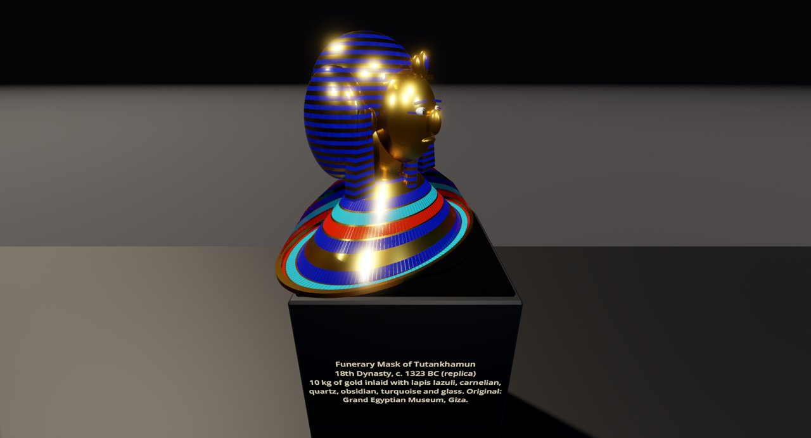
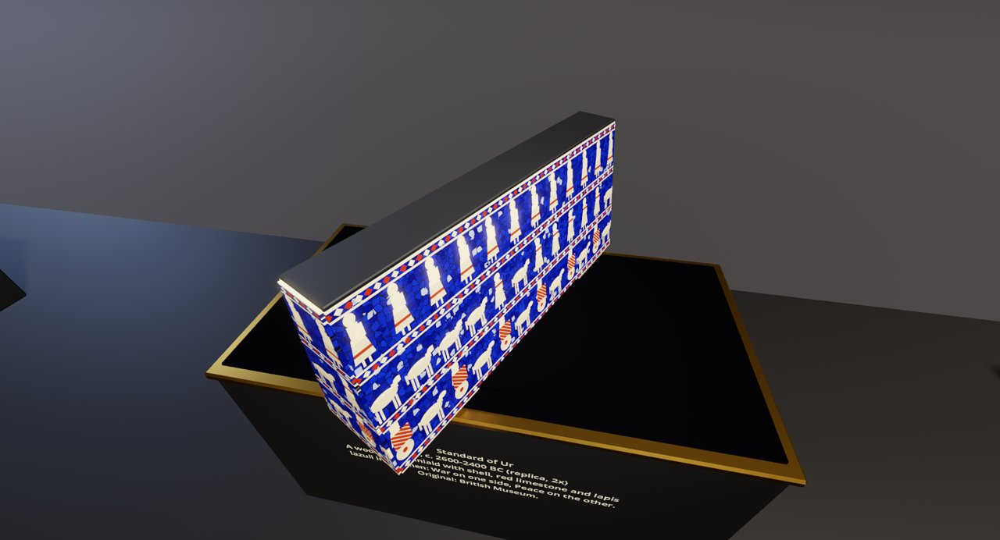
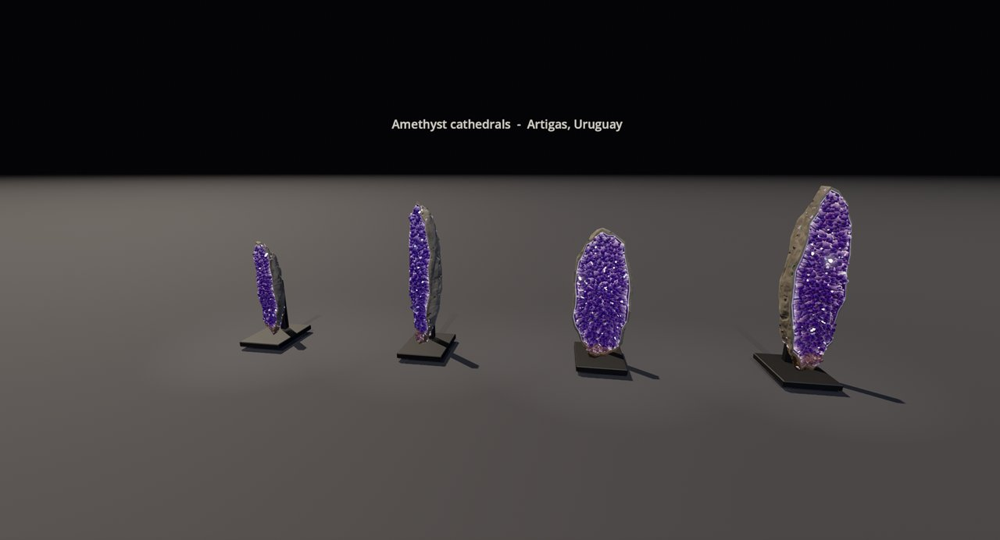
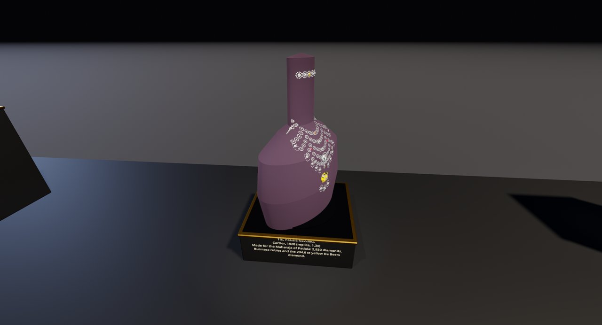

# Gem Gallery

A walkable 3D museum of real-world gems and treasures, made entirely from code in
the [Godot Engine](https://godotengine.org). It holds raw crystals, every classic diamond
cut, the world's most famous stones, crown jewels, Egyptian and Maya treasures, and
high jewellery. Pieces turn slowly on velvet turntables under pin lights, so the facets
flash as you watch.



| | |
|---|---|
|  |  |
|  |  |
|  |  |

## Just want to walk around? (Windows)

1. Download **GemGallery.zip** from the [latest release](../../releases/latest).
2. Unzip it, open the folder and double-click **GemGallery.exe**.
3. If Windows says "Windows protected your PC", click **More info**, then **Run anyway**. The game isn't signed.

The first launch can take a minute while your graphics card prepares its shaders.

**Controls:** click to look around · **WASD** walk · **Shift** run · **Space** jump ·
**E** pick up the gem you're looking at · **F** labels · **Esc** free the mouse · **Q** quit

## Get it running with an AI assistant

Paste this into Claude Code, Codex, Cursor or a similar coding agent:

> Clone https://github.com/Ericdataplus/gem-gallery and get it running. It's a Godot 4.7
> project. Read AGENTS.md first. Install Godot 4.7 if it's missing (on Windows,
> `winget install GodotEngine.GodotEngine`). Then run `setup.ps1` on Windows or `setup.sh`
> on Linux or macOS: it imports the project, bakes the halls once, and launches the gallery.

The agent can then add new pieces for you. AGENTS.md explains how to add one and the
rules that keep the gallery fast.

## Set it up yourself

You need [Godot 4.7](https://godotengine.org/download) and a GPU with Vulkan support.

```bash
git clone https://github.com/Ericdataplus/gem-gallery
cd gem-gallery
./setup.sh                                          # Linux / macOS
powershell -ExecutionPolicy Bypass -File setup.ps1  # Windows
```

The first run imports the project and **bakes** the halls, which takes about a minute
and opens a window that closes itself. After that, run `godot --path .` to play.

## What's inside

| Hall | Highlights |
|---|---|
| Raw specimens | 30+ minerals as found in nature: amethyst geodes, quartz clusters, jade, fluorite, celestite |
| Cut gems | Every classic cut in diamond, every gemstone in its signature cut, and a 600-stone treasure heap |
| Collector displays | Gem case, rainbow sapphires, a Mughal jewelled bowl, a diamond bib necklace, amethyst cathedrals |
| Legendary Gems | 22 famous stones shown at 6x real size: the Cullinans, Koh-i-Noor, Hope, Star of India, Hooker Emerald… |
| Egypt and the Maya | Tutankhamun's mask, a scarab pectoral, Pakal's jade mask, and lapis and jade pieces |
| Royal Treasury | The Imperial State Crown, St Edward's Crown, the Holy Roman crown, tiaras, carved rock crystal and lapis, the Standard of Ur |
| Collector's Wing | The Patiala necklace, loose-stone boxes, rings, Roman coins, Lord of Sipán regalia, mineral specimens, a gem-show booth |

## How it works

Every mesh and material is generated in GDScript. Nothing is generated when the game
starts, though. A **bake** step builds each hall once into a ready-made scene, and the
game **streams** halls in on worker threads as you walk.

Cut gems are **ray-traced inside their own facets**: real refractive indices, per-colour
dispersion (fire), total internal reflection and colour that deepens with the length of
the light's path. See [AGENTS.md](AGENTS.md) for the architecture and how to add pieces.

```
content/   procedural content library      halls/   floor plan, one recipe per hall
bake/      builds baked/<hall>.scn          core/    runtime: player, streaming, inspector, turntables
tools/     diagnostics + package.ps1 (builds the shareable Windows zip)
```

## Licence

MIT, see [LICENSE](LICENSE). Pieces are replicas or interpretations of real objects; the
plaques credit the real collections that hold them.
